**Language:** [한국어](README.md) | [日本語](README.ja.md)

> このREADMEはAIを使用して翻訳しました。不自然な表現が含まれる場合があります。

# Skea clock

> **スキアのアホ毛は世界一**

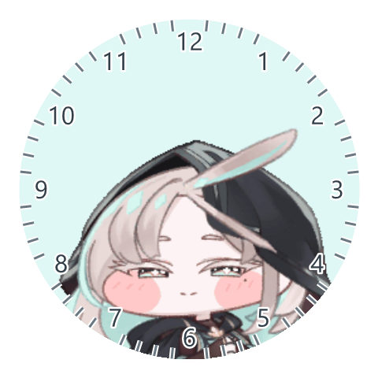

スキアを時計として使ってみましょう。  
Windowsの画面にスキアの時計を表示して、デコピンや頬を引っ張る操作、頭をなでる操作を楽しんだり、アラームを設定したりできます。

## ダウンロードと起動

インストールは不要です。

**[最新版をダウンロード (.exe)](https://github.com/junhwan123/SkeaClock/releases/latest/download/SkeaClock.exe)**

CPUやメモリの使用量が気になる場合は、**[低解像度版をダウンロード (.exe)](https://github.com/junhwan123/SkeaClock/releases/latest/download/SkeaClock_low.exe)**をご利用ください。

上記のリンクを使用するか、Releasesページから最新版をダウンロードしてください。

## 使い方

時計を**右クリック**すると、設定メニューが開きます。

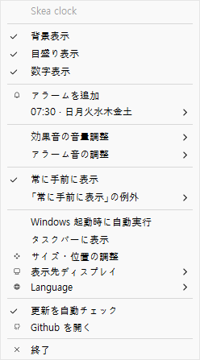

### 時計の見た目

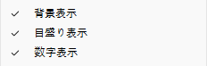

**背景表示**、**目盛り表示**、**数字表示**をそれぞれオン・オフに切り替えて、お好みの見た目に設定できます。

| すべてオフ | 背景・目盛りをオン | 背景・目盛り・数字をオン |
| ------- | ------------- | ------------------- |
|  |  | 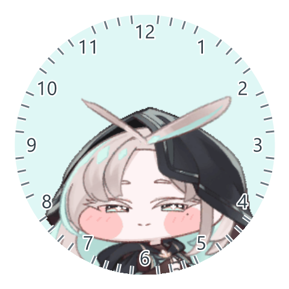 |

### アラーム

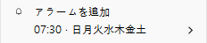

スキアが指定した時刻と曜日にアラームを鳴らしてくれます。右クリックメニューの**アラームを追加**から時刻と曜日を設定できます。

登録したアラームは設定メニューの**アラームを追加**の下に表示されます。各アラームのサブメニューから**アラームを編集**または**アラームを削除**を選択できます。

### サウンド設定

  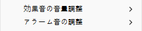
  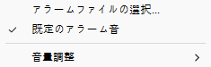

スキアの効果音とアラーム音は、それぞれ個別に設定できます。  
効果音は音量のみ調整できます。初期値は**80%**です。

アラーム音は音量だけでなく、音声ファイルも個別に設定できます。  
選択したファイルは**1つだけ**保存され、**既定のアラーム音**と選択した音声ファイルのどちらかを選べます。  
**ファイルが削除されたり移動されたりすると、選択が解除される**ため、ご注意ください。

### 常に手前に表示の設定

  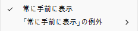
  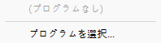

スキアの時計がほかのウィンドウよりも手前に表示され続けるように設定できます。  
**常に手前に表示**をオンにすると、ほかのプログラムを使用している間も時計を確認できます。チェックを外すと、ほかのウィンドウの背後に隠れる場合があります。

特定のプログラムを使用するとき、時計が手前に重ならないように例外を設定できます。  
**「常に手前に表示」の例外**でプログラムを選択すると、そのプログラムの使用中は時計がそのプログラムの背後に表示されます。もう一度選択すると例外が解除されます。  
一覧に目的のプログラムがない場合は、**プログラムを選択...**をクリックして、実行ファイルを直接追加できます。

### その他の項目

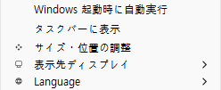

**Windows 起動時に自動実行**をオンにすると、Windowsのスタートアップに自動的に登録されます。Windowsの起動時にスキアの時計が自動的に起動します。

**タスクバーに表示**をオンにすると、スキアの時計がタスクバーにも表示されます。チェックを外すと、タスクバーから非表示にできます。

**サイズ・位置の調整**で、時計のサイズと位置を自由に調整できます。

**表示先ディスプレイ**から、時計を表示する画面を選択できます。サイズと位置のデータは画面ごとに個別に保存されます。

**Language**から表示言語を設定できます。韓国語と日本語に対応しています。

### 更新管理

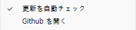

**更新を自動チェック**をオンにすると、3日に1回、プログラムの起動時にGithubに接続して、更新があるかどうかを確認します。

**Github を開く**ボタンから、更新を直接確認することもできます。

## 補足事項

このプログラムはAIを活用して制作しました。  
可能な限り最適化に配慮して制作していますが、不具合が発生する可能性があります。

設定データと各種アセットは、`%APPDATA%`フォルダー内の \Local\SkeaClock フォルダーに保存されます。  
関連データを残さず完全に削除したい場合は、.exeファイルだけでなく、そのフォルダーも削除してください。
