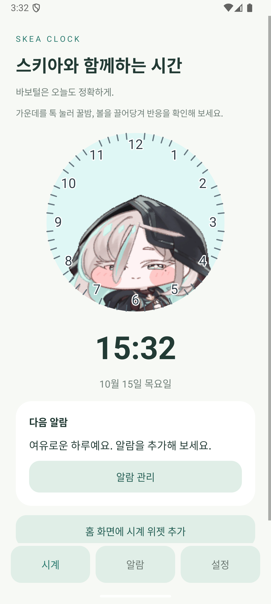
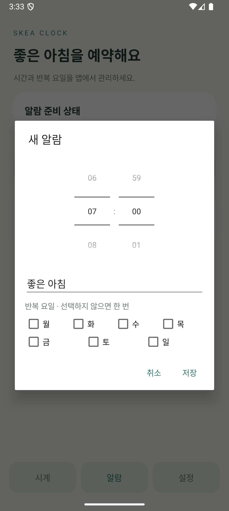
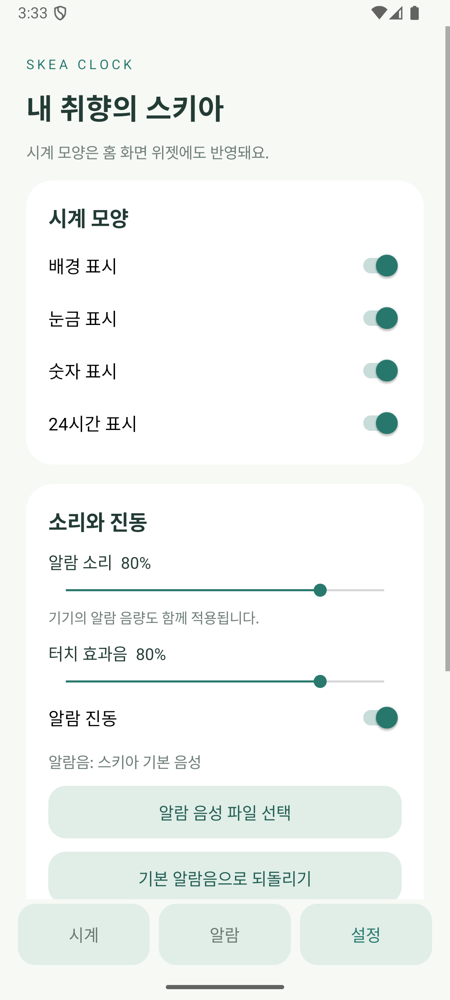
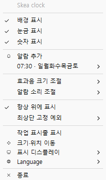
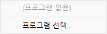

**Language:** [한국어](README.md) | [日本語](README.ja.md)

# Skea clock

> **스키아의 바보털은 세계제일**


스키아를 시계로 사용해 보세요.  
Windows 화면에 스키아 시계를 띄워 두고, 꿀밤과 볼 당기기 상호작용을 즐기거나 알람을 설정할 수 있습니다.

## Android 앱

스키아 캐릭터 시계, 알람, 캐릭터 상호작용을 Android 앱 화면과 홈 화면 위젯에서 사용할 수 있습니다.

<p>
  <a href="https://raw.githubusercontent.com/Adihang/SkeaClock-app/main/android/downloads/SkeaClock-Android-debug.apk">
    
  </a>
</p>

### 주요 기능

- 캐릭터가 움직일 때 시계 바늘도 함께 흔들리는 아날로그 시계
- 알람 추가·수정·삭제, 반복 요일, 알람음 파일, 진동, 다시 알림 설정
- 시계 배경·눈금·숫자와 12/24시간 표시, 알람·효과음 조절
- 앱에서 꿀밤과 볼 당기기 애니메이션 실행. 앱에서는 손가락을 떼면 바로 튕김 반응 재생
- 홈 화면 위젯에는 시계만 표시하고, 보이지 않는 5×5 터치 영역에서 꿀밤과 최대 16방향 볼 당기기 애니메이션을 앱 화면으로 이동하지 않고 바로 실행. 위젯 볼 당기기는 당김 자세를 2초 유지한 뒤 튕김 반응 재생
- Galaxy Z Flip의 지원 모델에서는 커버 화면 위젯에서도 캐릭터 상호작용 사용

### 앱 화면과 위젯

| 시계 화면 | 알람 설정 |
| --- | --- |
|  |  |

| 설정 화면 | 홈 화면 위젯 |
| --- | --- |
|  |  |

### 설치 방법

1. 위의 **Android APK 다운로드** 버튼을 눌러 APK를 받습니다.
2. 다운로드한 APK를 열고, 안내가 나오면 브라우저나 파일 앱의 **이 출처 허용**을 켜서 설치를 진행합니다.
3. 앱의 **알람** 탭에서 알람을 사용할 때 필요한 정확한 알람·알림 권한을 허용합니다.
4. 위젯은 홈 화면을 길게 눌러 **위젯 → 스키아 시계**를 추가합니다. 위젯에는 시계만 보입니다. 5×5 투명 입력 영역에서 가운데와 좌우 3칸, 그 바로 위 3칸을 누르면 위젯 안에서 꿀밤 애니메이션이, 나머지 19칸을 누르면 선택한 방향의 볼 당기기 애니메이션이 바로 실행됩니다. 이 배치는 16방향의 당김 방향을 제공합니다.

Galaxy Z Flip에서는 기기를 펼쳐 **설정 → 커버 화면 → 위젯**에서 스키아 시계를 추가합니다. 모델과 One UI 버전에 따라 커버 화면 위젯 또는 커버 화면 앱 실행을 지원하지 않을 수 있습니다.

이 APK는 직접 설치해 확인할 수 있는 **디버그 서명 빌드**입니다. Google Play 배포용 서명은 포함되어 있지 않습니다. 직접 빌드하려면 JDK 17 이상과 Android SDK Platform 36을 설치한 뒤 아래 명령을 실행합니다.

```sh
cd android
./gradlew assembleDebug lintDebug
```

빌드 결과: `android/app/build/outputs/apk/debug/app-debug.apk`. 알람 권한, Galaxy 커버 위젯 설정과 검증 방법은 [Android 상세 안내](android/README.md)를 참고하세요.

## 다운로드 및 실행

별도의 설치 과정은 필요하지 않습니다.

**[최신 버전 다운로드 (.exe)](https://github.com/junhwan123/SkeaClock/releases/latest/download/SkeaClock.exe)**

상단 경로를 사용하거나 release 페이지에서 최신 버전을 다운받으세요.

## 사용 가이드

시계에 **우클릭**하면 설정 메뉴가 열립니다.



### 시계 모양

**배경 표시**, **눈금 표시**, **숫자 표시**를 각각 켜거나 꺼서 원하는 모양으로 설정할 수 있습니다.

| 모두 끔 | 배경·눈금 켬 | 배경·눈금·숫자 켬 |
| ------- | ------------- | ------------------- |
|  |  |  |

### 알람

스키아가 원하는 시간과 요일에 알람을 울려 줍니다. 우클릭 메뉴의 **알람 추가**에서 시간과 요일을 설정할 수 있습니다.


등록한 알람은 설정 메뉴의 **알람 추가** 아래에 표시됩니다. 각 알람의 하위 메뉴에서 **알람 편집** 또는 **알람 삭제**를 선택할 수 있습니다.


### 소리 설정

스키아의 효과음과 알람 소리를 따로 설정할 수 있습니다.  
효과음 소리는 크기만 조절 가능합니다. 기본값은 **80%**입니다.


알람 소리는 크기 뿐만 아니라 음성 파일을 따로 설정할 수 있습니다.  
선택된 파일은 **하나만** 저장되며 기본 알람과 선택한 알람 중 원하는 걸 고를 수 있습니다.  
만약 **파일이 삭제되거나 이동되면 선택이 해제**되니 주의해주세요.


### 항상 위에 표시 설정

스키아 시계가 다른 창 위에 계속 보이도록 설정할 수 있습니다.  
**항상 위에 표시**를 켜면 다른 프로그램을 사용하면서도 시계를 볼 수 있습니다. 체크를 해제하면 다른 창 뒤로 가려질 수 있습니다.



특정 프로그램을 사용할 때는 시계가 앞을 가리지 않도록 예외를 설정할 수 있습니다.  
**최상단 고정 예외**에서 프로그램을 선택하면, 해당 프로그램을 사용하는 동안 시계가 그 프로그램 뒤에 표시됩니다. 다시 선택하면 예외가 해제됩니다.  
목록에 원하는 프로그램이 없다면 **프로그램 선택...**을 눌러 실행 파일을 직접 추가할 수 있습니다.

### 기타 항목

**작업 표시줄 표시**를 켜면 스키아 시계가 작업 표시줄에도 표시됩니다. 체크를 해제하면 작업 표시줄에서 숨길 수 있습니다.  
**크기·위치 이동**을 통해 시계의 크기와 위치를 원하는 대로 조절할 수 있습니다.  
**표시 디스플레이**를 통해 시계를 표시할 화면을 선택할 수 있습니다. 크기 및 위치 데이터는 화면별로 따로 저장됩니다.


**Language**를 통해 언어 설정이 가능합니다. 한국어랑 일본어를 지원합니다.

## 참고사항

해당 프로그램은 AI를 통해 제작되었습니다.  
가능한 최적화에 신경써서 제작하였으나 오류가 있을 수 있습니다.

설정과 프로그램 자료는 `%APPDATA%` 폴더 내 \Local\SkeaClock 폴더에 저장되어 있습니다.  
잔여 데이터 없이 완전 삭제를 원하시는 경우 .exe 파일뿐만 아니라 해당 폴더까지 삭제하시면 됩니다.
