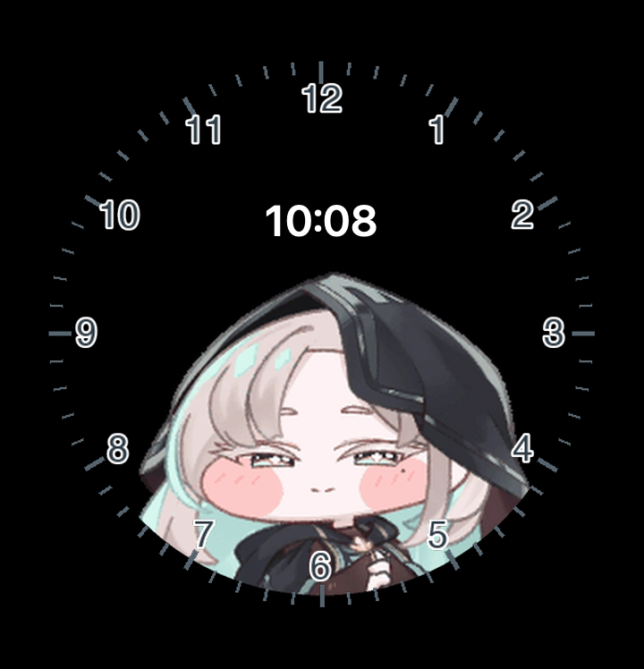

# 스키아 ClockFace · Galaxy Z Flip5

Galaxy Z Flip5 커버 화면에 Good Lock ClockFace로 적용하는 Watch Face Studio 디자인입니다. 일반 Android 홈 화면 위젯과 별도로 설치하며 APK에 포함되지 않습니다.

## 구성

- `SkeaClock-Flip5-ClockFace.wfs`: Watch Face Studio 프로젝트 아카이브
- `SkeaClock-Flip5-preview.png`: 720×748 디자인 미리보기 (10:08은 미리보기용 예시)
- `assets/flip5-face-art.png`: 순수 검정 바탕에 눈금·캐릭터를 합친 불투명 커버 화면 아트
- `assets/dial-markers.png`, `assets/skea-idle.webp`: 재구성 가능한 원본 레이어
- `assets/hour-hand.png`, `assets/minute-hand.png`: 기존 Android 시계 바늘 리소스

디자인은 720×748 캔버스를 순수 검정(`#000000`)으로 채우고 밝은 민트 원판을 제거해 OLED에서 검은 픽셀 비중을 높였습니다. 숫자·눈금과 캐릭터 프레임만 남기고, 현재 시각은 흰색 WFS 디지털 시계 컴포넌트(`[HOUR_0_23_Z]:[MIN_Z]`)로 표시합니다. 캐릭터 애니메이션과 꿀밤·볼 당기기 입력은 Android 앱 및 AppWidget 기능이므로 ClockFace 프로젝트에는 들어가지 않습니다.

## 적용

1. PC 또는 Mac에 Watch Face Studio를 설치하고 ClockFace 플러그인을 설치합니다.
2. Z Flip5에 Good Lock과 ClockFace 모듈을 설치하고 USB 디버깅을 켭니다. 기기는 One UI 5.1.1 이상이어야 합니다.
3. Watch Face Studio에서 `SkeaClock-Flip5-ClockFace.wfs`를 엽니다. 프로젝트가 열리지 않으면 새 프로젝트에서 **ClockFace / CoverScreen** 유형과 **Galaxy Z Flip5** 크기를 선택하고, `assets/flip5-face-art.png`를 배경 이미지로 가져온 뒤 중앙 정렬합니다. 이어 **Digital Clock > Time**을 추가하고 `[HOUR_0_23_Z]:[MIN_Z]` 태그를 지정합니다.
4. Watch Face Studio의 **Project > Run on Device**로 Z Flip5에 전송합니다.
5. 휴대폰의 **Good Lock > ClockFace > Cover screen > Studio**에서 스키아 시계를 선택하고 적용합니다.

삼성의 ClockFace 플러그인 경로는 기기에 직접 전송해 Good Lock의 Studio 항목에서 적용하며, 일반 앱처럼 스토어용 APK로 배포하지 않습니다. 지원 조건과 설치 단계는 [삼성 ClockFace 플러그인 안내](https://developer.samsung.com/watch-face-studio/plugin/user-guide.html) 및 [Flex Window Code Lab](https://developer.samsung.com/codelab/watch-face-studio/flex-window-customization.html)를 따릅니다.

## 검증 범위

프로젝트는 WFS `.wfs` ZIP 아카이브로 생성했고, 내부 JSON 및 리소스 경로와 ZIP 무결성을 검사했습니다. 현재 개발 환경에는 Watch Face Studio와 ClockFace 플러그인이 없어 WFS 편집기 열기 및 실제 Z Flip5 전송 검증은 하지 못했습니다. 첫 실행 때 프로젝트 타입이나 플러그인 호환 경고가 나오면 위 3번의 새 프로젝트 방식으로 동일 아트를 가져와 저장하면 됩니다.
