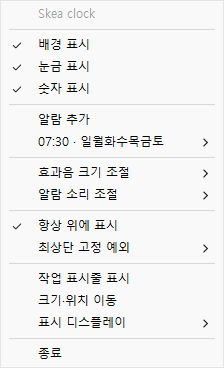
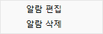
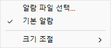
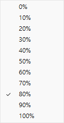
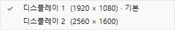

# README용 이미지

실제 프로그램의 이미지와 화면·메뉴 코드로 캡처한 PNG 12장입니다. 시계 이미지는 480×480 투명 배경이며, 메뉴 이미지는 Windows 기본 UI를 사용합니다. 메뉴와 알람 설정 창의 바깥 여백은 없으며, 알람 설정 창의 둥근 모서리 바깥은 투명합니다.

촬영용 표시 시각만 고정했습니다. PC 시각과 사용자 설정은 변경하지 않았으며, 메뉴의 07:30 알람은 설명용 예시입니다. 하위 메뉴는 각각 따로 캡처했습니다.

## 시계 화면

### 4시 10분 — 기본 표시


[원본 PNG](clock-0410.png)

### 10시 10분 — 표시 옵션 비교

| 배경·눈금·숫자 모두 끔 | 배경·눈금 켬 | 배경·눈금·숫자 모두 켬 |
| --- | --- | --- |
|  |  |  |
| [원본 PNG](clock-1010-none.png) | [원본 PNG](clock-1010-background-ticks.png) | [원본 PNG](clock-1010-all.png) |

## 우클릭 설정 메뉴



## 하위 메뉴

### 등록된 알람 — 편집·삭제



### 효과음 크기 조절


### 알람 소리 조절



### 알람 소리 크기 조절



### 최상단 고정 예외


촬영 환경에서 조회 결과가 비어 있는 상태입니다.

### 표시 디스플레이



## 알람 설정 창


## 루트 README에 첨부하기

```markdown

```
